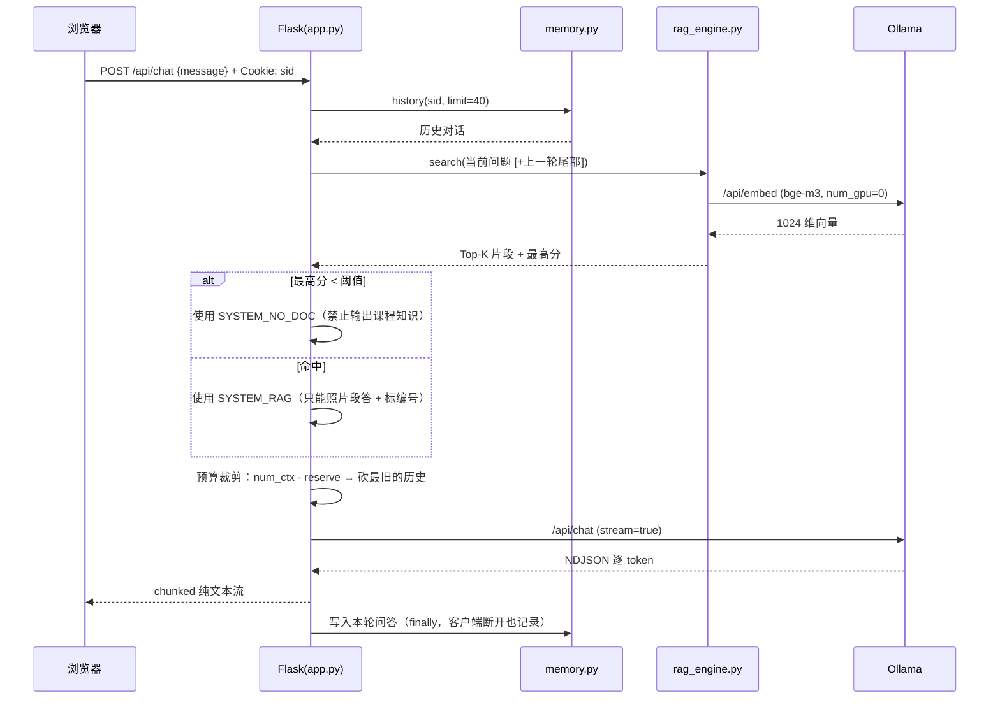

# Offline RAG Assistant

**在 8 GB 显存的笔记本上，跑一个断网可用、能查私有文档、还记得你上一句话的本地 AI 助教。**

> A fully offline RAG assistant for consumer GPUs — local LLM + local embeddings + hybrid context budgeting.
> No API key. No telemetry. No network after setup.

---

## 这个项目解决什么问题

市面上的 RAG 教程大多假设你有 24 GB 显存和稳定的外网。真实场景是：一台 8 GB 显存的笔记本、一间断网的教室、一份必须留在本地的教材 PDF。把开源方案直接搬过来，会撞上三个具体的墙：

| 痛点 | 常见做法 | 为什么会坏 | 本项目的做法 |
|---|---|---|---|
| **显存不够** | 生成模型 + embedding 模型都塞 GPU | Ollama 发现放不下，把 7B 整个退回 CPU，生成速度从 58 tok/s 掉到 5 tok/s | embedding 固定 `num_gpu=0` 跑 CPU，GPU 全留给生成模型；`ollama ps` 稳定显示 `100% GPU` |
| **模型爱编** | 在 prompt 里写"不知道就说不知道" | 7B 级别的模型对指令的服从性不可靠，照样一本正经胡说 | **架构级拦截**：检索相似度低于阈值时，模型根本没被调用，直接返回固定话术 |
| **没有记忆** | 每次请求独立发问 | 模型本身是无状态函数，"记忆"必须由调用方把历史重新喂进去 | SQLite 存会话 + token 预算裁剪，历史装不下时按轮次丢弃，绝不撑爆上下文 |

---

## 架构

```
                        ┌──────────────────────────── 浏览器（手机 / 电脑） ───────────────────────────┐
                        │  Tailwind UI · marked.js 渲染 · highlight.js 高亮 · 流式打字机               │
                        └───────────────────────────────────┬──────────────────────────────────────────┘
                                                            │ HTTP (同源, 无 CORS)
┌───────────────────────────────────────────────────────────▼──────────────────────────────────────────┐
│  app.py  —  路由层                                                                                    │
│    /api/chat     组装上下文 → 流式转发 → 落库                                                         │
│    /api/upload   接收文件 → 交给引擎入库                                                              │
│    /api/stats    知识库 / 记忆 / 预算状态                                                             │
└───────────────┬──────────────────────────────────────────────┬───────────────────────────────────────┘
                │                                              │
┌───────────────▼──────────────────┐            ┌──────────────▼──────────────────────────────────────┐
│  rag_engine.py                   │            │  memory.py                                          │
│  抽取 → 清洗 → 切块(500/100)      │            │  sessions(sid, turns)                               │
│  → bge-m3 编码 → SQLite 向量库    │            │  messages(sid, role, content)                       │
│  → 余弦检索 Top-K                │            │  一轮一问一答，一次事务写入                          │
└───────────────┬──────────────────┘            └──────────────┬──────────────────────────────────────┘
                │                                              │
                └──────────────────┬───────────────────────────┘
                                   │ HTTP 127.0.0.1:11434
                        ┌──────────▼───────────┐
                        │   Ollama (本机)       │
                        │  qwen2.5-coder:7b    │  100% GPU  ← 生成
                        │  bge-m3              │  100% CPU  ← 向量（不与生成抢显存）
                        └──────────────────────┘
```

### 一次提问的完整链路



---

## 功能

- **混合检索**：向量（语义）+ BM25（关键词）双路召回，RRF 融合排名。缩写/专有名词不再漏召 —— "BTB" 这种纯向量只有 0.25 分的查询，BM25 能精确命中
- **引用可定位**：每个片段记录字符区间，点 `[1]` 直接展开原文并高亮模型读到的段落
- **增量索引**：文件 sha256 未变则跳过，二次重建从分钟级降到 0 秒
- **本地 RAG**：PDF / TXT / Markdown 上传即刻入库，不需要改配置或重启
- **多轮记忆**：SQLite 持久化，刷新页面不丢；支持一键清空
- **双层防幻觉**：相似度阈值 + 区分度判据 + 提示词硬约束
- **上下文预算**：`num_ctx` 固定上限，历史按轮次裁剪，响应头 `X-Ctx` 可查分配明细
- **文档管理**：列表 / 删除 / 一键重建，全部在 UI 里完成
- **离线优先**：Tailwind、marked、highlight 全部本地化，断网不影响渲染
- **PWA**：可"添加到主屏幕"，全屏无地址栏，像原生 App
- **可观测**：结构化日志（控制台 + 轮转文件），每个失败分支都有 `log.exception`

### 检索质量基线（`python scripts/eval_rag.py`）

53 道评测题（38 道应命中 + 15 道应拒答），对示例语料实测：

| 指标 | 数值 |
|---|---|
| 召回命中率 | **97.4%** (37/38) |
| 拒答准确率 | **93.3%** (14/15) |
| 要点覆盖率 | 93.2%（top-1 片段包含答案关键词） |
| 检索延迟 | p50 40 ms / p95 48 ms |

优化过程（每一步都可复现）：

| 阶段 | 召回 | 拒答 | 说明 |
|---|---|---|---|
| 纯向量 + 绝对阈值 | 78.9% | 86.7% | 缩写查询全漏（"BTB" 仅 0.25 分） |
| + RRF 混合检索 | 84.2% | 93.3% | 排序改善是主要收益 |
| + BM25 双通道放行（调参后） | **97.4%** | **93.3%** | 关键词强命中可绕过向量阈值 |

---

## 快速开始

### 0. 前置条件

- Python 3.10+
- [Ollama](https://ollama.com/download) 已安装并运行（`ollama serve`）
- 建议显存 ≥ 6 GB（7B-Q4 约 4.8 GB）

### 1. 准备模型

```powershell
ollama pull qwen2.5-coder:7b     # 生成模型，约 4.7 GB
ollama pull bge-m3               # 向量模型，约 600 MB
```

> **官方源不可达时**（企业网/校园网常见）：用 GGUF 离线导入，效果一致
> ```powershell
> # 以 bge-m3 为例，先从 ModelScope 下载 bge-m3-Q8_0.gguf，再：
> "FROM D:\models\bge-m3-Q8_0.gguf" | Out-File -Encoding ascii Modelfile.bge
> ollama create bge-m3 -f Modelfile.bge
> ```

### 2. 安装依赖

```powershell
git clone https://github.com/Lucifer585-justin/offline-rag-assistant.git
cd offline-rag-assistant
python -m venv .venv
.\.venv\Scripts\Activate.ps1
pip install -r requirements.txt
```

### 3. 放入文档并启动

**Windows 用户可直接双击 `start.bat`**：自动检查 Ollama、打印局域网地址、启动服务。

```powershell
# 方式 A：把 PDF 丢进 data/docs，启动时自动入库
Copy-Item "D:\课件\计算机组成原理.pdf" data\docs\
python app.py --rebuild

# 方式 B：直接启动，然后在网页左侧上传（推荐）
python app.py
```

打开 <http://127.0.0.1:5000>。手机同网段访问 `http://<本机IP>:5000`。

```powershell
# 查本机局域网 IP
Get-NetIPAddress -AddressFamily IPv4 |
  Where-Object { $_.IPAddress -notlike '127.*' -and $_.InterfaceAlias -notmatch 'VMware' }
```

### 4. 验证真的离线

```powershell
Test-NetConnection 8.8.8.8 -InformationLevel Quiet                    # False
(Invoke-WebRequest http://127.0.0.1:5000/api/health -UseBasicParsing).Content
ollama ps                                                             # 100% GPU
```

---

## 配置

全部通过环境变量覆盖，默认值见 `.env.example`。

| 变量 | 默认 | 说明 |
|---|---|---|
| `OLLAMA_BASE` | `http://127.0.0.1:11434` | Ollama 地址 |
| `OLLAMA_MODEL` | `qwen2.5-coder:7b` | 生成模型 |
| `OLLAMA_EMBED_MODEL` | `bge-m3` | 向量模型（换模型必须重建库） |
| `OLLAMA_NUM_CTX` | `8192` | 上下文窗口，**与显存强相关** |
| `RESERVE_OUTPUT` | `1200` | 输出预留 token |
| `RAG_TOP_K` | `3` | 检索片段数 |
| `RAG_MIN_SCORE` | `0.45` | 低于此值直接拒答（防幻觉核心） |
| `RAG_MIN_MARGIN` | `0.015` | 多片段分数过于接近时判为噪声 |
| `RAG_BM25_MIN` | `2.5` | 关键词强命中的绝对门槛，可绕过向量阈值 |
| `CHUNK_SIZE` / `CHUNK_OVERLAP` | `500` / `100` | 切块粒度 |
| `WEB_HOST` / `WEB_PORT` | `0.0.0.0` / `5000` | 监听地址 |
| `MAX_UPLOAD_MB` | `50` | 单文件上限 |

**阈值怎么调**：先用 `python -c "from rag_engine import RAGEngine; from config import Config; e=RAGEngine(Config.load()); print(e.search('你的问题'))"` 看真实分数分布，再定。实测相关 0.60~0.72，无关 0.30~0.39。

---

## API

| 方法 | 路径 | 说明 |
|---|---|---|
| `GET` | `/api/stats` | 知识库块数、文档数、记忆轮数、预算参数 |
| `POST` | `/api/chat` | `{"message": "..."}` → 流式纯文本；响应头带 `X-Rag` / `X-Sources` / `X-Ctx` |
| `GET` | `/api/history` | 当前会话历史 |
| `POST` | `/api/reset` | 清空当前会话记忆 |
| `POST` | `/api/upload` | `multipart/form-data`，字段名 `file` |
| `GET` | `/api/documents` | 文档列表（含块数） |
| `DELETE` | `/api/documents/<name>` | 删除文档及向量 |
| `POST` | `/api/rebuild` | 清空并重新扫描 `data/docs` |
| `GET` | `/api/health` | Ollama 连通性 |

`X-Ctx` 示例（演示时按 F12 可直接展示上下文预算）：

```json
{"question_tokens":12,"system_tokens":1286,"context_tokens":994,
 "history_tokens":214,"history_kept":3,"history_dropped":0,
 "total_tokens":2506,"budget":6992}
```

---

## 目录结构

```
offline-rag-assistant/
├── app.py                 # 路由 + 上下文组装 + 流式转发
├── rag_engine.py          # 抽取 / 清洗 / 切块 / 编码 / 检索 / 文档管理
├── memory.py              # 会话与消息（SQLite）
├── config.py              # 配置（env 驱动）
├── logger.py              # 日志（控制台 + 轮转文件）
├── templates/index.html   # 单页前端（Tailwind + marked + highlight）
├── static/vendor/         # 本地化的前端依赖，断网可用（约 0.6 MB，故意进仓库）
├── data/
│   ├── docs/              # 放你的 PDF/TXT（.gitignore 只保留示例）
│   └── db/                # knowledge.db / sessions.db（不进仓库）
├── logs/                  # app.log（不进仓库）
├── scripts/smoke_test.py  # 端到端冒烟测试（上传→检索→多轮→删除）
├── start.bat              # Windows 一键启动
├── requirements.txt
├── .env.example
└── LICENSE
```

> `static/vendor/` 里的 5 个文件被有意提交进仓库：断网环境装不了 npm，页面又必须有样式和 Markdown 渲染。
> 代价是 0.6 MB，换来"clone 下来就能离线跑"。

---

## 实测数据

测试机：Windows 11 / RTX 5060 Laptop 8 GB / 32 GB RAM / Ollama 0.40.16

| 指标 | 数值 |
|---|---|
| 生成速度 | 58.6 tok/s（7B-Q4，100% GPU） |
| 预填充 | 555 tok/s |
| 检索延迟 | 30~35 ms（7 块，含 embedding 编码实测） / 约 200 ms（1 万块估算） |
| 单轮回答（命中） | 0.6~3.3 s |
| 未命中拒答 | 0.1 s（模型未加载） |
| 显存占用 | 6.2 / 8.1 GB |
| 上下文压力测试 | 两轮 2400 字长问 → total 5710 / 6992，未溢出 |

---

## 设计取舍

1. **为什么用 SQLite + numpy 而不是 Chroma/FAISS**
   零额外依赖（`sqlite3` 是标准库）、检索逻辑三行可讲清、单文件可拷贝。一万块以内暴力检索比服务化方案更快；规模上来再换 FAISS 不迟。

2. **为什么 embedding 跑 CPU**
   8 GB 显存里 7B 占 4.8 GB，bge-m3 再抢 0.7 GB 会让 Ollama 把 7B 整体退回 CPU。bge-m3 在 CPU 上编码一句话约 100 ms，这个交换非常划算。

3. **为什么未命中时仍然调用模型**
   因为要保住多轮记忆（"我叫什么"同样检索不到）。但会切换到 `SYSTEM_NO_DOC`，禁止输出任何课程知识 —— 用提示词约束"闲聊可以、专业不行"。

4. **为什么历史按轮次丢弃而不是摘要**
   摘要需要额外一次模型调用，延迟翻倍且可能引入新的幻觉。裁剪是可预测的、零成本的，适合演示与教学场景。长期记忆是 Roadmap 里的事。

---

## 已知限制

- 扫描版 PDF 抽不出文本，需要先 OCR（未内置）
- 单进程 Flask 开发服务器，并发 >5 时建议换 `waitress`
- 会话按 Cookie 隔离，换浏览器即新会话；未做账号体系
- 表格与公式抽取依赖 PDF 本身的文本层，复杂排版可能丢结构

## Roadmap

- [ ] 混合检索（BM25 + 向量）提升专有名词召回
- [ ] 会话历史摘要，支持超长对话
- [ ] 多知识库切换（每门课一个库）
- [ ] Docker 镜像 + 一键部署脚本
- [ ] 评测集与自动回归（阈值调优用）

---

## License

[MIT](LICENSE) © 2026 YG

本项目仅做本地部署与教学演示，模型能力与输出内容由所选开源模型决定。
